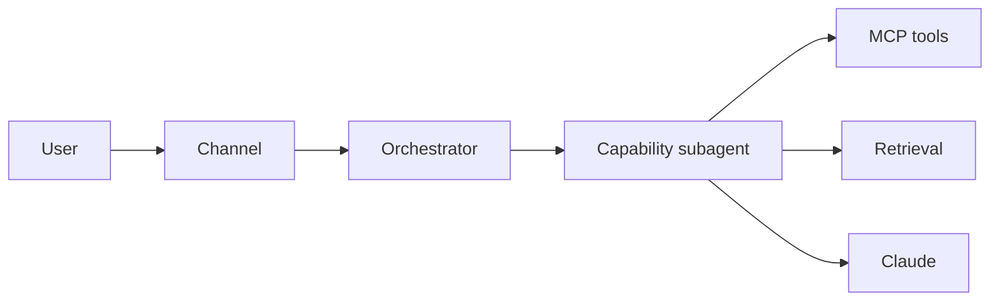

# <App name>: Architecture

Status: Draft | Reviewed | Approved    Owner: <name>    Date: <date>

## 1. Problem and wedge
- Users and channel:
- Job to be done:
- Success KPI (baseline → target):
- Out of scope for this phase:

## 2. Pattern and runtime
- Rung chosen (single call / workflow / agent / orchestrator + subagents), and why the lower rung is not enough:
- Runtime: Agent SDK / Messages API
- Provider: Anthropic API / Amazon Bedrock (region, inference profile)

## 3. Layers
| Layer | Design | Claude primitive |
|---|---|---|
| Channels | | |
| Orchestrator | | |
| Capabilities (subagents) | | |
| Skills | | |
| Context (MCP + retrieval) | | |
| Model routing | | |
| Controls | | |

## 4. Data flow

Trust boundaries:
Data classification and allowed models:

## 5. Tools
| Tool | Read/Write | Approval | Roles allowed |
|---|---|---|---|

## 6. Model routing
| Step | Default tier | Escalation trigger | Local SLM? |
|---|---|---|---|

## 7. Failure modes
| Failure | Detection | User sees | Recovery |
|---|---|---|---|

## 8. Evals and tests
- Golden set:
- Graders:
- Regression trigger:

## 9. Cost and latency
- Tokens per task:
- Tasks per day:
- Monthly estimate:
- p95 target:

## 10. Review scores
| Section | Score | Gap to 10 |
|---|---|---|

## 11. Open decisions
| Decision | Owner | Due |
|---|---|---|
