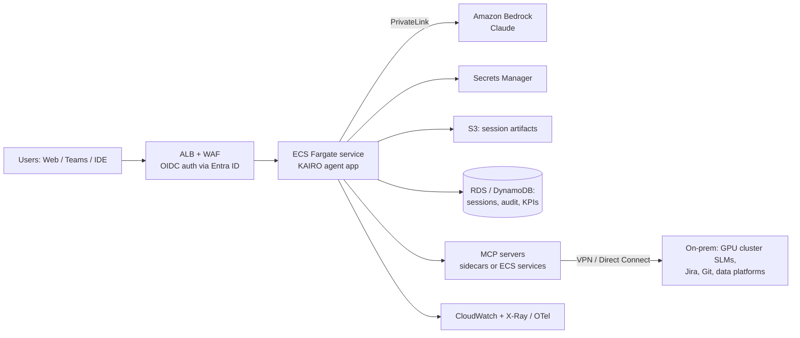

# Reference infrastructure (ECS Fargate)

## Components
| Component | Purpose | Notes |
|---|---|---|
| ALB + AWS WAF | TLS, routing, rate limits | ALB's built-in OIDC authentication can front Entra ID; pass the user's identity to the app |
| ECS Fargate service | Runs the agent app | Private subnets; at least 2 tasks across AZs; long idle timeout for streaming |
| MCP servers | Tool access | stdio servers inside the app container; shared HTTP servers as their own ECS services |
| Secrets Manager + KMS | Tokens for Jira, Git and others | Injected as task secrets; rotated |
| S3 | Session files, generated docs | Encrypted; lifecycle rules |
| RDS Postgres or DynamoDB | Session state, approvals queue, audit trail, KPI events | Postgres with pgvector can also host retrieval at this scale |
| CloudWatch, X-Ray / OpenTelemetry | Logs, traces, metrics, alarms | One trace per task: model calls and tool calls |
| Site-to-Site VPN / Direct Connect | Hybrid link to the on-prem GPU cluster | The model router calls local SLMs (vLLM/Ollama endpoints) over this link |

## Sizing for about 150 users (starting point; measure and adjust)
- Assume 10–20% concurrently active, and 1–3 concurrent agent sessions per active user at peak.
- Each Agent SDK session is a subprocess. Start at 2 vCPU / 4 GB per task, allowing roughly 4–8 concurrent sessions per task, and load-test to find the real number.
- Autoscale on a custom metric (active sessions per task), not on CPU alone.
- Minimum of 2 tasks; maximum set so that worst-case Bedrock spend stays inside budget.

## Session isolation
- Give each session its own working directory (in `/tmp`, or EFS if sessions must survive task restarts) and delete it afterwards.
- Keep the agent's built-in shell and file tools disabled unless needed. If they are needed, keep them scoped to the session directory.

## Alarms (minimum)
- 5xx rate above 2% for 5 minutes
- p95 latency above target
- Bedrock throttling count
- Daily token spend above budget
- Failed approvals or tool errors spiking
- Unhealthy task count
